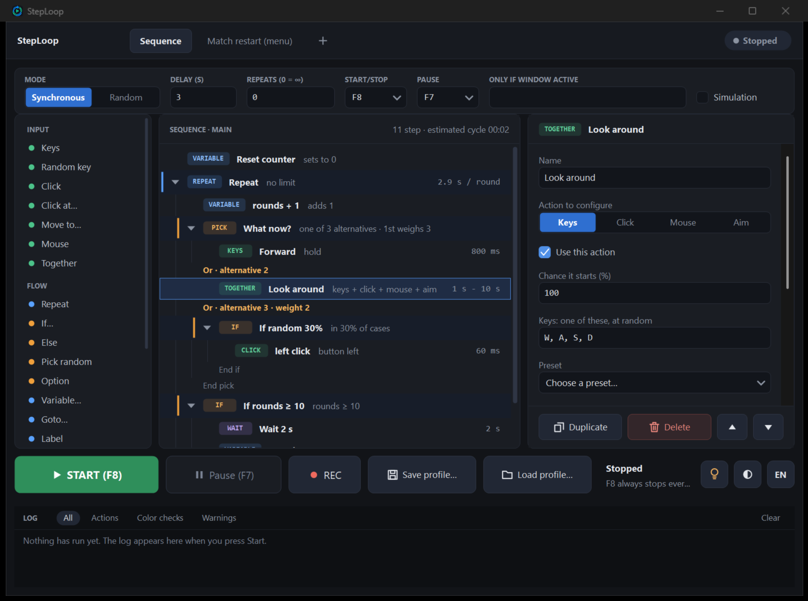
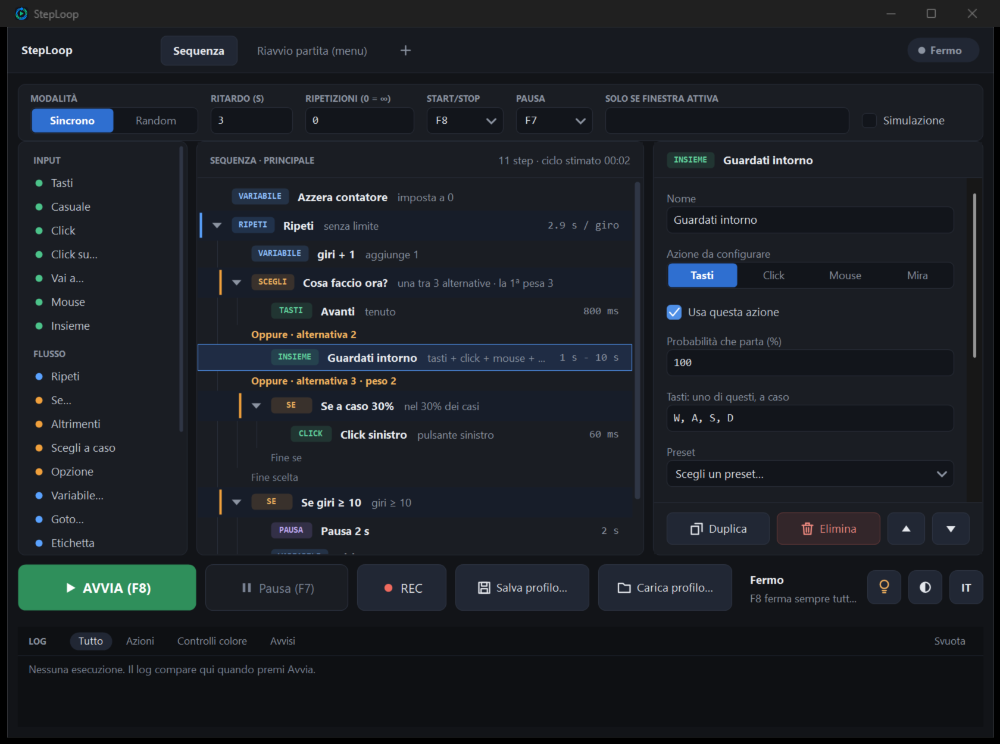

<p align="center">
  
</p>

# StepLoop

**English** · [Italiano](#italiano)

**Sequence-based automation for Windows** — keys, clicks, mouse movement, loops, screen-color conditions, random picks
and variables, with random durations and pauses. Dark/light UI, English/Italian, a single `.exe`.



> ⚠️ **Anti-cheat.** Anti-cheat systems can detect automated input (macros, keys and mouse movements generated by a program).
> Using this app may lead to penalties or an account ban: the choice and the risk are yours.
> The software is provided "as is", without any warranty. Always respect the terms of service of the games and programs
> you use it with, and the rules of events.

## Download

The ready-to-use executable (`StepLoop.exe`, a single file, no installation) is on the
**[Releases](https://github.com/Kingly26/StepLoop/releases/latest)** page. Windows 10/11 with .NET Framework 4.x (already included).
The exe is not digitally signed: SmartScreen or your antivirus may ask for confirmation on the first run.

## What it does

You build a **sequence of steps** by dragging blocks from the palette (or double-clicking them) and run it with one key
(default **F8**, pause **F7**).

| Family | Blocks |
| --- | --- |
| **Input** | Keys · Random key (from a set) · Click · Click at… · Move to… · Mouse (relative movement) · **Together** |
| **Flow** | Repeat (also "until a color…") · If… / Else · **Pick random** / Option · **Variable** · Goto / Label · Exit · **Reset** · Stop |
| **Wait** | Wait (fixed or random) · Wait for color (appears / disappears) |

- **Randomness everywhere:** durations and pauses with a from–to range and occasional "long" values; *Random* mode with weights.
- **Pick random:** runs a single alternative drawn at random (with weights); each *Option* can hold several steps.
- **Variables and If:** set / add / subtract / random number; *If* checks a screen color, a variable or a probability.
- **Reset:** from anywhere — even deep inside loops and Ifs — it abandons everything and starts again from the first step of the
  sequence, without stopping the macro. It does not count as a finished repetition, and it can also clear the variables.
- **Together:** keys, click, mouse and aim start at the same moment, each with its own random duration
  (by default 1–3 s, with a 10% chance of up to 10 s).
- **Color conditions:** pick from the screen (F9), area preview, *Test now* button.
- **Multiple conditions (OR / AND):** every condition (*If*, *Repeat until*, *Wait for color* / *to disappear*) can have up to 4 checks —
  another color, a variable or a probability — and you choose whether any one of them (OR) or all of them (AND) must be true.
  For example, a loop can exit when color A *or* color B shows up. The end-of-match color accepts extra colors too.
- **Recording (REC)** of clicks and keys, **automatic match restart** (the "Match restart (menu)" tab).
- **While running:** live panel (current block, color check, variables, next steps), filterable log, pause, *Simulation*
  (no real input is sent).
- **Profiles** are JSON files (`profiles/` folder), saved/loaded from the bottom bar.

## Build

You only need Windows with **.NET Framework 4.x** (included in Windows 10/11): no external dependencies, no SDK to install.

```bat
build.bat
```

This produces `StepLoop.exe` in the project folder (using the `csc.exe` C# compiler of .NET Framework, C# 5).
The icon is `icon/StepLoop.ico`, generated from `icon/logo.png` with `icon/make-icon-from-logo.cs`.

## Project structure

```
src/        C# source code (WinForms, custom-drawn controls)
icon/       logo, .ico icon and the tools that generate it
profiles/   sample profiles (JSON)
docs/       images for the documentation
build.bat   build script
```

## Usage notes

- `F8` always starts/stops the macro, even inside the game; `F7` pauses it and releases the keys.
- Color waits work with the game windowed or borderless (in exclusive fullscreen the pixels cannot be read).
- If the game runs as administrator, run StepLoop as administrator too.
- Always try profiles with **Simulation** before using them for real.
- For very long sessions, lower the game's resolution and graphics quality and cap the FPS.

## Contributing and support

Bug reports, ideas and pull requests are welcome (English or Italian):
[open an issue](https://github.com/Kingly26/StepLoop/issues/new/choose) ·
[contributing guide](.github/CONTRIBUTING.md) ·
[security policy](.github/SECURITY.md) ·
[accessibility statement](.github/ACCESSIBILITY.md).

## License

[MIT](LICENSE) — you may use, modify and redistribute the code freely, keeping the copyright notice.
The software is provided "as is", without warranty.

---

# Italiano

**[English](#steploop)** · Italiano

**Automazione a sequenze per Windows** — tasti, click, movimenti del mouse, cicli, condizioni sui colori dello schermo,
scelte casuali e variabili, con durate e pause casuali. Interfaccia scura/chiara, italiano/inglese, un solo `.exe`.



> ⚠️ **Anti-cheat.** Gli anti-cheat possono rilevare gli input automatici (macro, tasti e movimenti del mouse generati da un programma).
> Usare questa app può portare a sanzioni o al ban dell'account: la scelta e il rischio sono tuoi.
> Il software è fornito "così com'è", senza garanzie. Rispetta sempre i termini di servizio dei giochi e dei programmi
> con cui lo usi e le regole degli eventi.

## Scarica

L'eseguibile pronto all'uso (`StepLoop.exe`, un solo file, nessuna installazione) è nella pagina
**[Releases](https://github.com/Kingly26/StepLoop/releases/latest)**. Windows 10/11, .NET Framework 4.x (già incluso).
L'exe non è firmato digitalmente: SmartScreen o l'antivirus possono chiedere conferma al primo avvio.

## Cosa fa

Costruisci una **sequenza di passi** trascinando i blocchi dalla palette (o con doppio clic) e la fai girare con un tasto
(predefinito **F8**, pausa **F7**).

| Famiglia | Blocchi |
| --- | --- |
| **Input** | Tasti · Tasto casuale (da un insieme) · Click · Click su… · Vai a… · Mouse (movimento relativo) · **Insieme** |
| **Flusso** | Ripeti (anche "finché un colore…") · Se… / Altrimenti · **Scegli a caso** / Opzione · **Variabile** · Goto / Etichetta · Esci · **Reset** · Stop |
| **Attesa** | Pausa (fissa o casuale) · Attendi colore (compare / sparisce) |

- **Casualità ovunque:** durate e pause con intervallo da–a e valori "lunghi" occasionali; modalità *Random* con pesi.
- **Scegli a caso:** esegue una sola alternativa estratta a caso (con pesi); ogni *Opzione* può contenere più passi.
- **Variabili e Se:** imposta/somma/sottrai/numero a caso; il *Se* controlla un colore, una variabile o una probabilità.
- **Reset:** da qualsiasi punto — anche dentro cicli e Se — abbandona tutto e ricomincia dal primo passo della sequenza,
  senza fermare la macro. Non conta come una ripetizione completata e può azzerare anche le variabili.
- **Insieme:** tasti, click, mouse e mira partono nello stesso istante, ciascuno con la propria durata casuale
  (di default 1–3 s, con il 10% delle volte fino a 10 s).
- **Condizioni sui colori:** selezione dallo schermo (F9), anteprima dell'area, pulsante *Testa ora*.
- **Più condizioni (OR / AND):** ogni condizione (*Se*, *Ripeti fino a*, *Attendi colore* / *che sparisca*) può avere fino a 4 controlli —
  un altro colore, una variabile o una probabilità — e scegli se basta una qualsiasi (OR) o servono tutte (AND).
  Per esempio un ciclo può uscire quando compare il colore A *oppure* il colore B. Anche il colore di fine partita accetta altri colori.
- **Registrazione (REC)** di click e tasti, **riavvio automatico partita** (scheda "Riavvio partita (menu)").
- **Esecuzione:** pannello live (blocco corrente, controllo colore, variabili, prossimi step), log filtrabile, pausa, *Simulazione*
  (nessun input reale).
- **Profili** in JSON (cartella `profiles/`), salvataggio/caricamento dalla barra in basso.

## Compilare

Serve solo Windows con **.NET Framework 4.x** (incluso in Windows 10/11): nessuna dipendenza esterna, nessun SDK da installare.

```bat
build.bat
```

Produce `StepLoop.exe` nella cartella del progetto (compilatore `csc.exe` di .NET Framework, C# 5).
L'icona è `icon/StepLoop.ico`, ricavata da `icon/logo.png` con `icon/make-icon-from-logo.cs`.

## Struttura

```
src/        codice sorgente C# (WinForms, disegno dei controlli personalizzato)
icon/       logo, icona .ico e strumenti per generarla
profiles/   profili di esempio (JSON)
docs/       immagini per la documentazione
build.bat   compilazione
```

## Note d'uso

- `F8` avvia/ferma sempre la macro, anche dentro il gioco; `F7` la mette in pausa rilasciando i tasti.
- Le attese a colore funzionano con il gioco in finestra o a schermo intero senza bordi (in schermo intero esclusivo i pixel non si leggono).
- Se il gioco gira come amministratore, avvia anche StepLoop come amministratore.
- Prova sempre i profili con **Simulazione** prima di usarli davvero.
- Per sessioni molto lunghe conviene ridurre risoluzione e qualità grafica del gioco e limitare gli FPS.

## Contribuire e supporto

Segnalazioni, idee e pull request sono benvenute (in italiano o in inglese):
[apri una issue](https://github.com/Kingly26/StepLoop/issues/new/choose) ·
[guida per contribuire](.github/CONTRIBUTING.md) ·
[politica di sicurezza](.github/SECURITY.md) ·
[dichiarazione di accessibilità](.github/ACCESSIBILITY.md).

## Licenza

[MIT](LICENSE) — puoi usare, modificare e ridistribuire il codice liberamente, mantenendo l'avviso di copyright.
Il software è fornito "così com'è", senza garanzie.
