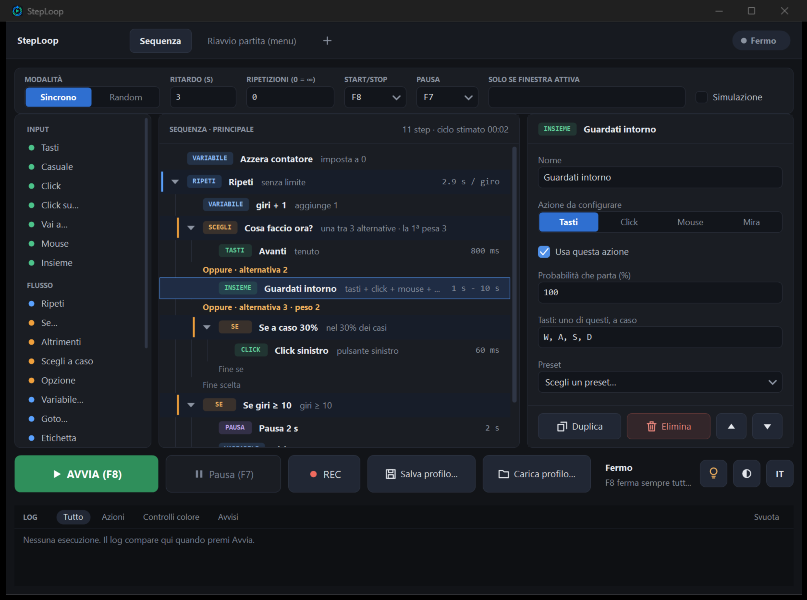

<p align="center">
  
</p>

# StepLoop

**Automazione a sequenze per Windows** — tasti, click, movimenti del mouse, cicli, condizioni sui colori dello schermo,
scelte casuali e variabili, con durate e pause casuali. Interfaccia scura/chiara, italiano/inglese, un solo `.exe`.

**Sequence-based automation for Windows** — keys, clicks, mouse movement, loops, screen-color conditions, random picks
and variables, with random durations and pauses. Dark/light UI, Italian/English, a single `.exe`.



> ⚠️ **Anti-cheat.** Gli anti-cheat possono rilevare gli input automatici (macro, tasti e movimenti del mouse generati da un programma).
> Usare questa app può portare a sanzioni o al ban dell'account: la scelta e il rischio sono tuoi.
> Il software è fornito "così com'è", senza garanzie. Rispetta sempre i termini di servizio e le regole degli eventi.
> *Anti-cheat systems can detect automated input. Using this app may lead to penalties or an account ban — use at your own risk and
> respect the terms of service of the games and programs you use it with.* Progetto indipendente, non affiliato a Ubisoft né ad altri.

## Cosa fa

Costruisci una **sequenza di passi** trascinando i blocchi dalla palette (o con doppio clic) e la fai girare con un tasto
(predefinito **F8**, pausa **F7**).

| Famiglia | Blocchi |
| --- | --- |
| **Input** | Tasti · Tasto casuale (da un insieme) · Click · Click su… · Vai a… · Mouse (movimento relativo) · **Insieme** |
| **Flusso** | Ripeti (anche "finché un colore…") · Se… / Altrimenti · **Scegli a caso** / Opzione · **Variabile** · Goto / Etichetta · Esci · Stop |
| **Attesa** | Pausa (fissa o casuale) · Attendi colore (compare / sparisce) |

- **Casualità ovunque:** durate e pause con intervallo da–a e valori "lunghi" occasionali; modalità *Random* con pesi.
- **Scegli a caso:** esegue una sola alternativa estratta a caso (con pesi); ogni *Opzione* può contenere più passi.
- **Variabili e Se:** imposta/somma/sottrai/numero a caso; il *Se* controlla un colore, una variabile o una probabilità.
- **Insieme:** tasti, click, mouse e mira partono nello stesso istante, ciascuno con la propria durata casuale
  (di default 1–3 s, con il 10% delle volte fino a 10 s).
- **Condizioni sui colori:** selezione dallo schermo (F9), anteprima dell'area, pulsante *Testa ora*.
- **Registrazione (REC)** di click e tasti, **riavvio automatico partita** (scheda "Riavvio partita (menu)").
- **Esecuzione:** pannello live (blocco corrente, controllo colore, variabili, prossimi step), log filtrabile, pausa, *Simulazione*
  (nessun input reale).
- **Profili** in JSON (cartella `profili/`), salvataggio/caricamento dalla barra in basso.

## Compilare

Serve solo Windows con **.NET Framework 4.x** (incluso in Windows 10/11): nessuna dipendenza esterna, nessun SDK da installare.

```bat
build.bat
```

Produce `StepLoop.exe` nella cartella del progetto (compilatore `csc.exe` di .NET Framework, C# 5).
L'icona è `icona/StepLoop.ico`, ricavata da `icona/logo.png` con `icona/make-icon-da-logo.cs`.

## Struttura

```
src/        codice sorgente C# (WinForms, disegno dei controlli personalizzato)
icona/      logo, icona .ico e strumenti per generarla
profili/    profili di esempio (JSON)
docs/       immagini per la documentazione
build.bat   compilazione
```

## Note d'uso

- `F8` avvia/ferma sempre la macro, anche dentro il gioco; `F7` la mette in pausa rilasciando i tasti.
- Le attese a colore funzionano con il gioco in finestra o a schermo intero senza bordi (in schermo intero esclusivo i pixel non si leggono).
- Se il gioco gira come amministratore, avvia anche StepLoop come amministratore.
- Prova sempre i profili con **Simulazione** prima di usarli davvero.
- Per sessioni molto lunghe conviene ridurre risoluzione e qualità grafica del gioco e limitare gli FPS.

## Licenza

Nessuna licenza è ancora stata scelta: finché non ne viene aggiunta una, tutti i diritti sono riservati all'autore.
